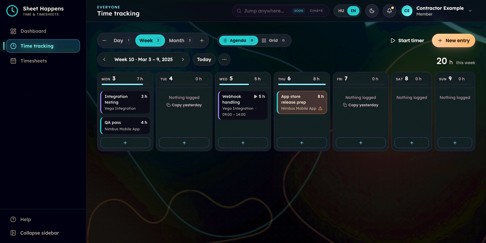
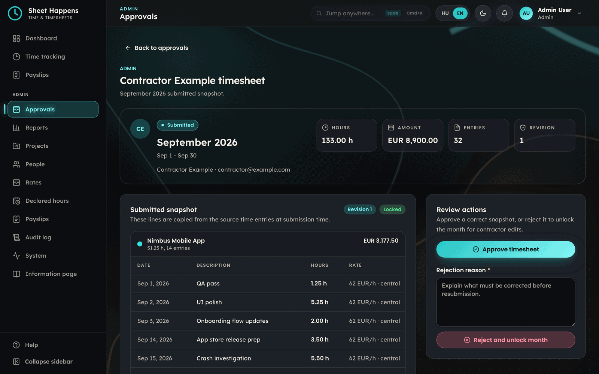
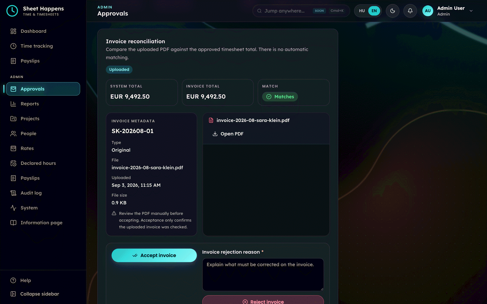
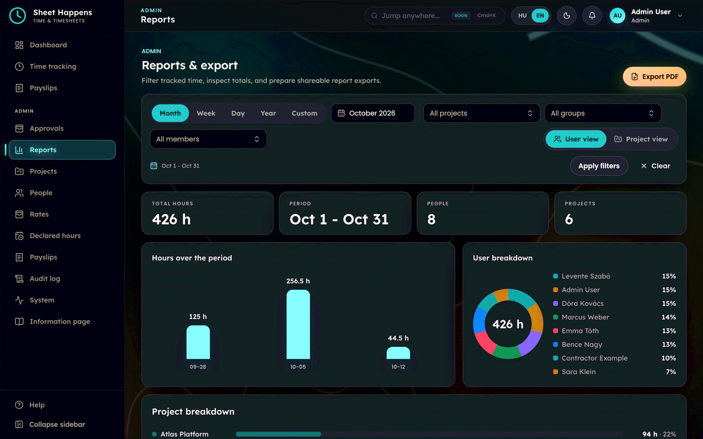
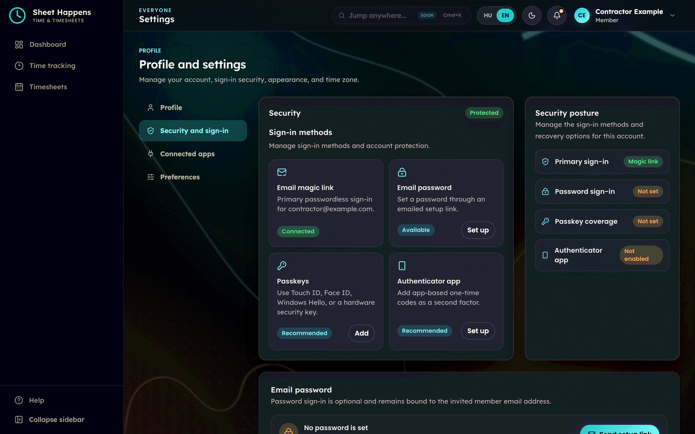

<div align="center">

<h1>Sheet Happens</h1>

<h3>The open-source time and timesheet app for companies that work with contractors</h3>

<p>
  <a href="https://sheethappens.rolloutit.net">Website</a> ·
  <a href="https://youtu.be/6xhXj7_6j0w">Video overview</a> ·
  <a href="docs/self-hosting.md">Self-hosting</a> ·
  <a href="docs/README.md">Documentation</a> ·
  <a href="CONTRIBUTING.md">Contributing</a>
</p>

<p>
  <a href="LICENSE"></a>
  <a href="https://github.com/rolloutit/sheet-happens/actions/workflows/ci.yml"></a>
</p>

<picture>
  <source media="(prefers-color-scheme: light)" srcset="docs/images/time-week-light.png">
  
</picture>

</div>

## Video overview

[](https://youtu.be/6xhXj7_6j0w)

## Why Sheet Happens

Companies that work with both employees and contractors need more than a stopwatch. Tracked hours
have to become an approved monthly timesheet, and a contractor's invoice has to be checked against
exactly those approved hours before anyone pays it. Most tools that do this are SaaS products that
keep your people's hours, rates and invoices on someone else's servers. Sheet Happens covers the
whole path, from time entry to paid invoice, and runs on your own infrastructure.

## Features

**Timesheets and invoices**

- **Immutable timesheet revisions.** Submitting a month snapshots its entries and resolved rates and
  locks the period. Approved numbers never recalculate from live data; a correction is a new
  revision, and older revisions stay for audit.
- **Contractor invoice verification.** Contractors upload their invoice PDFs against approved hours;
  admins review them next to the timesheet snapshot and accept or reject them with a reason. The
  workflow runs from submitted through approved, invoiced and accepted to paid. Sheet Happens never
  issues invoices itself.
- **Internal rates** that are effective-dated and visible only to the member and admins.
- **E-mail notifications** for every workflow step, plus weekly hours and monthly invoice reminders.

**Time tracking**

- Weekly grid, entry form and a running timer, with descriptions recalled from your earlier entries.
- A 24-hour daily cap and locked periods, enforced on the server.
- Tracked or declared hours: members whose hours live in another company's system declare one figure
  per project per month with a proof PDF.

**Reports and documents**

- Reports by date range, project, project group and member.
- PDF export rendered with [Typst](https://typst.app), in a cost-free version (hours only) or an
  internal one with rates and costs. Edit the figures before generating without touching the source
  entries.
- Payslip uploads for employees, and an in-app information page for company notes.

**Access and security**

- Invite-only accounts with admin and member roles, and employee or contractor profiles.
- Sign in with a magic link, a passkey or a password, with authenticator-app 2FA and backup codes;
  optional Google sign-in restricted to your Google Workspace domains.
- Audit log of material business changes.

**AI agents**

- A built-in [MCP server](docs/mcp-server.md) protected by OAuth 2.1. Claude and other MCP clients
  can read and log time as the signed-in member, under the same period locks, daily cap and audit
  log as the web app.

**Platform**

- Single-tenant and self-hosted: one company per installation, your Postgres and your S3-compatible
  storage, no built-in telemetry.
- Hungarian and English throughout; light, dark and system theme; works on phones.
- Your own organisation name and logo ([branding](docs/self-hosting.md#branding)).

## Screenshots

| Timesheet approval                                                                    | Invoice verification                                                          |
| ------------------------------------------------------------------------------------- | ----------------------------------------------------------------------------- |
|  |     |
| **Reports**                                                                           | **Sign-in methods**                                                           |
|                 |  |

More in [`docs/images`](docs/images/README.md).

## Quick start (local development)

You need Node.js as pinned in [`.nvmrc`](.nvmrc), pnpm (`corepack enable`) and Docker.

```bash
git clone https://github.com/rolloutit/sheet-happens.git && cd sheet-happens
pnpm install
pnpm setup:git              # once per clone: local git hooks and push defaults
cp .env.example .env.local  # the defaults work for local development
pnpm db:dev                 # Postgres + MinIO in Docker, migrations, fake demo data
pnpm dev                    # http://localhost:3000
```

Then open <http://localhost:3000/accept-invite?token=dev-admin-invite-token>, click **Email sign-in
link**, open the magic link printed in the `pnpm dev` terminal and activate the seeded admin account.
Admins must set up an authenticator app next; `AUTH_SECURITY_SETUP_MODE="optional"` in `.env.local`
skips that locally. Use `localhost`, not `127.0.0.1`. Details: [`docs/local-dev-db.md`](docs/local-dev-db.md).

## Self-hosting

Sheet Happens builds into a single Docker image from the included `Dockerfile` and needs Postgres
and S3-compatible object storage. The [self-hosting guide](docs/self-hosting.md) covers a Docker
Compose setup, Railway, every environment variable, the first admin, upgrades and backups.

## Tech stack

[Next.js](https://nextjs.org) (App Router) and React 19 · [Prisma](https://www.prisma.io) and
PostgreSQL · [Better Auth](https://www.better-auth.com) · Tailwind CSS v4 and Radix UI ·
[next-intl](https://next-intl.dev) · [Typst](https://typst.app) · Storybook, Vitest and Playwright

## Documentation

Start at [`docs/README.md`](docs/README.md). The most useful pages:
[self-hosting](docs/self-hosting.md), [domain model](docs/domain-model.md),
[auth and user management](docs/auth-user-management.md) and the [MCP server](docs/mcp-server.md).

## Contributing

Contributions are welcome, from typo fixes to translations to features. Read
[CONTRIBUTING.md](CONTRIBUTING.md) first and open an issue or discussion before a large change.
Every user-facing string needs both a Hungarian and an English version. AI-assisted contributions are
fine: [`CLAUDE.md`](CLAUDE.md) is the project's guide for coding agents. Please follow the
[Code of Conduct](CODE_OF_CONDUCT.md).

## Security

Please do not report vulnerabilities in public issues. Follow [SECURITY.md](SECURITY.md) and use
GitHub's [private vulnerability reporting](https://github.com/rolloutit/sheet-happens/security/advisories/new).

## Support

- **Community:** questions in [GitHub Discussions](https://github.com/rolloutit/sheet-happens/discussions),
  bugs and ideas in [Issues](https://github.com/rolloutit/sheet-happens/issues). See
  [SUPPORT.md](SUPPORT.md).
- **Need help running it?** Sheet Happens is free to self-host under the AGPL-3.0. If you'd rather
  not run it yourself, [Rollout IT](https://rolloutit.net) offers paid support, setup and hosting,
  and custom development. The money funds the maintenance of this project.

## License

Copyright (C) 2026 Rollout IT

Sheet Happens is free software, licensed under the
[GNU Affero General Public License v3.0](LICENSE) (`AGPL-3.0-only`). If you run a modified version
as a network service, you must offer its source code to its users.

## Credits

Built and maintained by [Rollout IT](https://rolloutit.net), with thanks to
[everyone who has contributed](https://github.com/rolloutit/sheet-happens/graphs/contributors).

<a href="https://github.com/rolloutit/sheet-happens/graphs/contributors">
  
</a>

Magyarul: [sheethappens.rolloutit.net](https://sheethappens.rolloutit.net)
