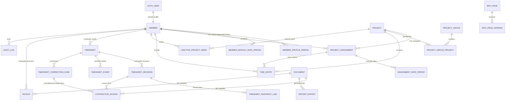

# Database Schema Design

Date: 2026-07-01

## Purpose

This document translates `docs/domain-model.md` into a PostgreSQL schema design. It is intentionally
not a Prisma migration yet. The next step should be implementing this as `prisma/schema.prisma` plus
raw SQL migrations for PostgreSQL constraints that Prisma cannot express cleanly.

Recommended database stack:

- PostgreSQL on Railway.
- Prisma as ORM and migration tool.
- Better Auth Prisma adapter for auth-owned tables.
- Cloudflare R2 for file bytes; Postgres stores document metadata only.

## Naming And Type Conventions

- Physical table names: snake_case plural nouns.
- Prisma model names can stay PascalCase and use `@@map`.
- Primary keys: UUID, generated by Postgres (`gen_random_uuid()`).
- Timestamps: `timestamptz`, stored in UTC.
- Business dates: `date`.
- Date periods use half-open ranges: `[valid_from, valid_to)`. A null `valid_to` means open-ended.
- Monthly periods use `period_start` as the first day of the month and `period_end` as the exclusive
  first day of the next month.
- Durations: integer minutes.
- Money/rates: `numeric(14,2)` plus `currency_code char(3)`.
- JSON snapshots: `jsonb` only for render snapshots, filters, provider payload summaries, and audit
  details. Do not store core relational facts only in JSON.
- Soft deletion preferred for referenced business entities: `deleted_at timestamptz`. Hard delete is
  reserved for unreferenced setup mistakes. GDPR erasure should be implemented as anonymization and
  scrubbing of unnecessary personal data while preserving legally required records.

Recommended Postgres extensions:

- `pgcrypto` for UUID generation.
- `citext` for case-insensitive email.
- `btree_gist` for exclusion constraints on effective-dated ranges.

## High-Level ERD

## Auth-Owned Tables

Better Auth should generate and own its tables. Expected table names depend on Better Auth
configuration, but conceptually include:

- `user`
- `session`
- `account`
- `verification`
- `passkey`
- `two_factor`

Domain tables reference the Better Auth user id through `members.auth_user_id`.

Do not duplicate password, account linking, passkey, TOTP, session, or verification state in domain
tables.

## Enums

Recommended logical enums:

- `member_role`: `admin`, `member`
- `member_status`: `invited`, `active`, `inactive`, `deleted`
- `member_profile_type`: `employee`, `contractor`
- `invitation_status`: `pending`, `accepted`, `expired`, `revoked`
- `project_status`: `active`, `inactive`, `archived`
- `entry_source`: `grid`, `form`, `timer`
- `timesheet_status`: `submitted`, `rejected`, `approved`, `invoiced`, `invoice_rejected`,
  `accepted`, `paid`
- `timesheet_event_type`: `submitted`, `approved`, `rejected`, `unlocked`, `resubmitted`,
  `correction_opened`, `cancellation_invoice_uploaded`, `corrected_revision_submitted`,
  `invoice_uploaded`, `invoice_accepted`, `invoice_rejected`, `correction_closed`, `paid`
- `timesheet_correction_status`: `open`, `cancellation_required`, `correction_in_progress`,
  `corrected_invoice_required`, `closed`, `cancelled`
- `rate_source`: `member_default`, `project_override`
- `document_type`: `contractor_invoice`, `report_export`, `payslip`
- `document_status`: `pending`, `available`, `failed`, `deleted`
- `invoice_role`: `original`, `replacement`, `cancellation`, `corrected`
- `invoice_status`: `uploaded`, `accepted`, `rejected`, `replaced`, `cancelled`, `deleted`
- `report_mode`: `cost_free`, `internal`
- `report_view`: `user`, `project`
- `info_page_status`: `draft`, `published`, `archived`
- `notification_type`: `invite`, `password_reset`, `weekly_hours_reminder`,
  `monthly_invoice_reminder`, `timesheet_submitted`, `timesheet_approved`, `timesheet_rejected`,
  `invoice_uploaded`, `invoice_rejected`, `invoice_accepted`, `timesheet_paid`
- `delivery_status`: `queued`, `sent`, `failed`, `skipped`
- `payslip_status`: `available`, `missing`, `processing`, `failed`

Prisma can model these as enums. Postgres enum migrations are acceptable, but changing enum values
later needs deliberate migrations.

## Identity Tables

### members

Domain profile for an authenticated or invited person.

Key columns:

- `id uuid primary key`
- `auth_user_id text unique null` references Better Auth user id after activation
- `email citext not null unique`
- `first_name text not null`
- `last_name text not null`
- `display_name text not null`
- `role member_role not null default 'member'`
- `status member_status not null default 'invited'`
- `current_profile member_profile_type not null`
- `default_currency_code char(3) not null default 'EUR'`
- `timezone text not null default 'Europe/Budapest'`
- `locale text not null default 'hu'`
- `activated_at timestamptz null`
- `inactivated_at timestamptz null`
- `deleted_at timestamptz null`
- `created_at timestamptz not null`
- `updated_at timestamptz not null`
- `created_by_member_id uuid null references members(id)`
- `updated_by_member_id uuid null references members(id)`

Important indexes:

- unique `email`
- unique `auth_user_id` where `auth_user_id is not null`
- `(status, current_profile)`
- `(role, status)`

Notes:

- `current_profile` is denormalized for fast filtering. The historical source is
  `member_profile_periods`.
- `deleted` should be soft deletion unless the member has no dependent records.

### member_profile_periods

Effective-dated profile history.

Key columns:

- `id uuid primary key`
- `member_id uuid not null references members(id)`
- `profile member_profile_type not null`
- `valid_from date not null`
- `valid_to date null`
- `reason text null`
- `created_by_member_id uuid null references members(id)`
- `created_at timestamptz not null`

Constraints:

- `valid_to is null or valid_to > valid_from`
- no overlapping profile periods per member
- exactly one current profile period should exist per active member, enforced in domain logic plus a
  partial index if useful

Raw SQL recommendation:

- Exclusion constraint using `daterange(valid_from, coalesce(valid_to, 'infinity'::date), '[)')`.

### invitations

Invite-only access allowlist and activation tracking.

Key columns:

- `id uuid primary key`
- `email citext not null`
- `first_name text not null`
- `last_name text not null`
- `role member_role not null default 'member'`
- `profile member_profile_type not null`
- `status invitation_status not null default 'pending'`
- `member_id uuid null references members(id)`
- `token_hash text null`
- `expires_at timestamptz not null`
- `accepted_at timestamptz null`
- `revoked_at timestamptz null`
- `invited_by_member_id uuid not null references members(id)`
- `created_at timestamptz not null`

Indexes:

- `(email, status)`
- `(token_hash)` unique where not null
- `(expires_at)` for cleanup

Invitation acceptance links are valid for 72 hours. Resending an invitation should rotate
`token_hash` and set `expires_at` to 72 hours after the resend time.

## Project Tables

### projects

Key columns:

- `id uuid primary key`
- `name text not null`
- `slug text not null unique`
- `status project_status not null default 'active'`
- `starts_on date null`
- `ends_on date null`
- `is_internal boolean not null default false`
- `notes text null`
- `created_at timestamptz not null`
- `updated_at timestamptz not null`
- `created_by_member_id uuid null references members(id)`
- `updated_by_member_id uuid null references members(id)`
- `deleted_at timestamptz null`

Constraints:

- `ends_on is null or ends_on >= starts_on`

Indexes:

- `(status)`
- `(starts_on, ends_on)`
- trigram or lower-name search can be added later for global search.

### project_groups

Key columns:

- `id uuid primary key`
- `name text not null`
- `slug text not null unique`
- `description text null`
- `active boolean not null default true`
- `created_at timestamptz not null`
- `updated_at timestamptz not null`
- `deleted_at timestamptz null`

### project_group_projects

Join table.

Key columns:

- `project_group_id uuid not null references project_groups(id)`
- `project_id uuid not null references projects(id)`
- `created_at timestamptz not null`
- primary key `(project_group_id, project_id)`

Domain rule:

- Project groups are current-only organization helpers. Historical exports preserve their output via
  report render snapshots, not effective-dated group membership.

### project_assignments

Key columns:

- `id uuid primary key`
- `member_id uuid not null references members(id)`
- `project_id uuid not null references projects(id)`
- `active boolean not null default true`
- `valid_from date not null`
- `valid_to date null`
- `notes text null`
- `created_at timestamptz not null`
- `updated_at timestamptz not null`
- `created_by_member_id uuid null references members(id)`
- `updated_by_member_id uuid null references members(id)`

Constraints:

- `valid_to is null or valid_to > valid_from`
- no overlapping assignment periods for the same member/project

Indexes:

- `(member_id, active)`
- `(project_id, active)`
- `(member_id, project_id)`
- date-range GiST exclusion for overlapping assignment windows

## Rate Tables

### member_default_rate_periods

Central effective-dated rates for both employees and contractors.

Key columns:

- `id uuid primary key`
- `member_id uuid not null references members(id)`
- `valid_from date not null`
- `valid_to date null`
- `hourly_rate numeric(14,2) not null`
- `currency_code char(3) not null`
- `created_at timestamptz not null`
- `created_by_member_id uuid not null references members(id)`
- `note text null`

Constraints:

- `hourly_rate >= 0`
- `valid_to is null or valid_to > valid_from`
- no overlapping periods per member
- if `currency_code` changes from the previous period, `valid_from` must be the first day of a
  future month, or today when today is the first day of the month; enforce in service logic

Indexes:

- `(member_id, valid_from)`
- date-range GiST exclusion per member

### assignment_rate_periods

Project-specific contractor override rates.

Key columns:

- `id uuid primary key`
- `project_assignment_id uuid not null references project_assignments(id)`
- `valid_from date not null`
- `valid_to date null`
- `hourly_rate numeric(14,2) not null`
- `currency_code char(3) not null`
- `created_at timestamptz not null`
- `created_by_member_id uuid not null references members(id)`
- `note text null`

Constraints:

- `hourly_rate >= 0`
- `valid_to is null or valid_to > valid_from`
- no overlapping override periods per assignment
- if `currency_code` changes from the previous period, `valid_from` must be the first day of a
  future month, or today when today is the first day of the month; enforce in service logic

Indexes:

- `(project_assignment_id, valid_from)`
- date-range GiST exclusion per assignment

Domain rule:

- Only contractor assignments should have rows here. Enforce in service logic because it requires
  checking profile history.

## Time Tracking Tables

### time_entries

Committed source-of-truth work records.

Key columns:

- `id uuid primary key`
- `member_id uuid not null references members(id)`
- `project_id uuid not null references projects(id)`
- `project_assignment_id uuid not null references project_assignments(id)`
- `local_date date not null`
- `timezone text not null`
- `started_at timestamptz null`
- `ended_at timestamptz null`
- `duration_minutes integer not null`
- `description text not null default ''`
- `source entry_source not null`
- `locked_by_timesheet_revision_id uuid null references timesheet_revisions(id)`
- `created_at timestamptz not null`
- `updated_at timestamptz not null`
- `deleted_at timestamptz null`
- `created_by_member_id uuid null references members(id)`
- `updated_by_member_id uuid null references members(id)`

Constraints:

- `duration_minutes > 0`
- `ended_at is null or started_at is null or ended_at > started_at`
- project id must match assignment project id, enforced in service logic or trigger
- member id must match assignment member id, enforced in service logic or trigger

Indexes:

- `(member_id, local_date)`
- `(project_id, local_date)`
- `(project_assignment_id, local_date)`
- `(locked_by_timesheet_revision_id)`
- partial index on non-deleted rows

Not hard constraints:

- Daily total > 24h.
- Overlapping entries.
- Future date.
- Very long sessions.

Those are warnings stored or computed by the time-tracking module.

### running_timers

Operational state for live timers.

Key columns:

- `id uuid primary key`
- `member_id uuid not null references members(id)`
- `project_id uuid not null references projects(id)`
- `project_assignment_id uuid not null references project_assignments(id)`
- `description text not null default ''`
- `started_at timestamptz not null`
- `timezone text not null`
- `created_at timestamptz not null`

Constraints/indexes:

- one active timer per member: unique `(member_id)`

### time_entry_drafts

Autosave for grid/form input.

Key columns:

- `id uuid primary key`
- `member_id uuid not null references members(id)`
- `draft_key text not null`
- `payload jsonb not null`
- `updated_at timestamptz not null`

Constraints/indexes:

- unique `(member_id, draft_key)`

### inactive_project_weeks

Key columns:

- `id uuid primary key`
- `member_id uuid not null references members(id)`
- `project_id uuid not null references projects(id)`
- `week_start_date date not null`
- `timezone text not null`
- `note text null`
- `created_at timestamptz not null`

Constraints/indexes:

- unique `(member_id, project_id, week_start_date)`
- `(week_start_date)`

## Timesheet Tables

### timesheets

One contractor monthly workflow container. The current status is the status of the current revision.

Key columns:

- `id uuid primary key`
- `contractor_member_id uuid not null references members(id)`
- `period_start date not null`
- `period_end date not null`
- `currency_code char(3) not null`
- `status timesheet_status not null`
- `current_revision_id uuid null references timesheet_revisions(id)`
- `current_revision_number integer not null default 0`
- `submitted_at timestamptz null`
- `approved_at timestamptz null`
- `accepted_at timestamptz null`
- `paid_at timestamptz null`
- `created_at timestamptz not null`
- `updated_at timestamptz not null`
- `created_by_member_id uuid null references members(id)`
- `updated_by_member_id uuid null references members(id)`

Constraints:

- unique `(contractor_member_id, period_start)`
- `period_start` must be first day of month, enforce in service logic or DB check
- `period_end` must be the exclusive first day of the next month

Indexes:

- `(status, period_start)`
- `(contractor_member_id, status)`
- `(period_start, period_end)`

Domain rule:

- `contractor_member_id` must have contractor profile during the period.
- A contractor/month is single-currency. Submission is blocked if resolved lines would span multiple
  currencies.
- `not_created` and `missing` are not stored in this table.
- `status` mirrors the current revision status for query speed.

### timesheet_revisions

Immutable submitted snapshots for a contractor month.

Key columns:

- `id uuid primary key`
- `timesheet_id uuid not null references timesheets(id)`
- `revision_number integer not null`
- `status timesheet_status not null`
- `correction_case_id uuid null references timesheet_correction_cases(id)`
- `created_from_revision_id uuid null references timesheet_revisions(id)`
- `superseded_by_revision_id uuid null references timesheet_revisions(id)`
- `submitted_at timestamptz not null`
- `approved_at timestamptz null`
- `accepted_at timestamptz null`
- `paid_at timestamptz null`
- `rejected_at timestamptz null`
- `rejection_reason text null`
- `currency_code char(3) not null`
- `total_minutes integer not null`
- `total_amount numeric(14,2) not null`
- `created_at timestamptz not null`
- `created_by_member_id uuid not null references members(id)`

Constraints:

- unique `(timesheet_id, revision_number)`
- `revision_number > 0`
- `total_minutes >= 0`
- `total_amount >= 0`

Indexes:

- `(timesheet_id, revision_number)`
- `(status, submitted_at)`
- `(correction_case_id)`

Domain rules:

- Rows are immutable after creation except status/timestamp fields that move the workflow forward.
- Editing source time entries after an invoiced or accepted revision creates a later revision; it
  never mutates an older snapshot.
- `timesheets.current_revision_id` points at the active revision for the month.

### period_locks

Current and historical lock records for contractor month edits.

Key columns:

- `id uuid primary key`
- `member_id uuid not null references members(id)`
- `period_start date not null`
- `timesheet_id uuid not null references timesheets(id)`
- `timesheet_revision_id uuid null references timesheet_revisions(id)`
- `locked_at timestamptz not null`
- `locked_by_member_id uuid not null references members(id)`
- `unlocked_at timestamptz null`
- `unlocked_by_member_id uuid null references members(id)`
- `unlock_reason text null`

Indexes/constraints:

- unique active lock `(member_id, period_start)` where `unlocked_at is null`
- `(timesheet_id)`
- `(timesheet_revision_id)`

### timesheet_snapshot_lines

Frozen line-level snapshot for a revision.

Key columns:

- `id uuid primary key`
- `timesheet_revision_id uuid not null references timesheet_revisions(id)`
- `source_time_entry_id uuid not null references time_entries(id)`
- `member_id uuid not null references members(id)`
- `project_id uuid not null references projects(id)`
- `project_assignment_id uuid not null references project_assignments(id)`
- `local_date date not null`
- `description text not null`
- `duration_minutes integer not null`
- `rate_source rate_source not null`
- `source_rate_period_id uuid null`
- `hourly_rate numeric(14,2) not null`
- `currency_code char(3) not null`
- `line_amount numeric(14,2) not null`
- `created_at timestamptz not null`

Constraints:

- unique `(timesheet_revision_id, source_time_entry_id)`
- `duration_minutes > 0`
- `hourly_rate >= 0`
- `line_amount >= 0`

Indexes:

- `(timesheet_revision_id)`
- `(project_id, local_date)`

### timesheet_correction_cases

Correction workflow records for invoiced or accepted revisions.

Key columns:

- `id uuid primary key`
- `timesheet_id uuid not null references timesheets(id)`
- `opened_from_revision_id uuid not null references timesheet_revisions(id)`
- `corrected_revision_id uuid null references timesheet_revisions(id)`
- `cancellation_invoice_id uuid null references contractor_invoices(id)`
- `status timesheet_correction_status not null`
- `reason text not null`
- `opened_by_member_id uuid not null references members(id)`
- `opened_at timestamptz not null`
- `closed_by_member_id uuid null references members(id)`
- `closed_at timestamptz null`

Indexes:

- `(timesheet_id, status)`
- `(opened_from_revision_id)`
- `(corrected_revision_id)`

Domain rules:

- If a real invoice has already been accepted or paid-relevant for the incorrect revision, the
  correction case requires a cancellation invoice before the corrected invoice can be accepted.
- The corrected revision is a new immutable revision for the same contractor/month.
- The original incorrect revision and invoice remain visible as audit history.

### timesheet_events

User-visible workflow history.

Key columns:

- `id uuid primary key`
- `timesheet_id uuid not null references timesheets(id)`
- `timesheet_revision_id uuid null references timesheet_revisions(id)`
- `correction_case_id uuid null references timesheet_correction_cases(id)`
- `event_type timesheet_event_type not null`
- `actor_member_id uuid not null references members(id)`
- `reason text null`
- `metadata jsonb not null default '{}'`
- `created_at timestamptz not null`

Indexes:

- `(timesheet_id, created_at)`
- `(timesheet_revision_id, created_at)`
- `(correction_case_id, created_at)`
- `(event_type, created_at)`

## Document And Invoice Tables

### documents

Generic private file metadata.

Key columns:

- `id uuid primary key`
- `type document_type not null`
- `status document_status not null default 'pending'`
- `owner_member_id uuid null references members(id)`
- `storage_bucket text not null`
- `storage_key text not null unique`
- `original_filename text not null`
- `content_type text not null`
- `byte_size bigint not null`
- `checksum_sha256 text null`
- `uploaded_by_member_id uuid not null references members(id)`
- `created_at timestamptz not null`
- `deleted_at timestamptz null`
- `deleted_by_member_id uuid null references members(id)`

Indexes:

- `(type, status)`
- `(owner_member_id, type)`
- `(created_at)`

### contractor_invoices

Invoice document rows linked to a contractor timesheet revision.

Key columns:

- `id uuid primary key`
- `timesheet_id uuid not null references timesheets(id)`
- `timesheet_revision_id uuid not null references timesheet_revisions(id)`
- `correction_case_id uuid null references timesheet_correction_cases(id)`
- `document_id uuid not null references documents(id)`
- `role invoice_role not null`
- `status invoice_status not null default 'uploaded'`
- `invoice_number text not null`
- `declared_amount numeric(14,2) not null`
- `currency_code char(3) not null`
- `references_invoice_id uuid null references contractor_invoices(id)`
- `uploaded_by_member_id uuid not null references members(id)`
- `reviewed_by_member_id uuid null references members(id)`
- `reviewed_at timestamptz null`
- `rejection_reason text null`
- `created_at timestamptz not null`
- `replaced_by_invoice_id uuid null references contractor_invoices(id)`

Indexes:

- `(timesheet_id, status)`
- `(timesheet_revision_id, role, status)`
- `(correction_case_id)`
- `(document_id)` unique
- `(invoice_number)`

Domain rules:

- Original/corrected invoice upload is allowed only when the target revision status is `approved` or
  `invoice_rejected`.
- Invoice number, declared amount, and currency are required metadata, but still treated as
  human-entered review data.
- `role = cancellation` must reference the invoice it cancels and should have a negative declared
  amount.
- A corrected invoice must link to the correction case and corrected revision.
- Rejection does not unlock time entries.

## Reporting Tables

### report_exports

Generated PDF report metadata and required render snapshot.

Key columns:

- `id uuid primary key`
- `title text not null`
- `mode report_mode not null`
- `view report_view not null`
- `filters jsonb not null`
- `timezone text not null`
- `render_snapshot jsonb not null`
- `document_id uuid null references documents(id)`
- `generated_by_member_id uuid not null references members(id)`
- `created_at timestamptz not null`

Indexes:

- `(generated_by_member_id, created_at)`
- `(mode, created_at)`

Notes:

- `render_snapshot` stores the exact exported content after on-the-fly edits.
- If an admin chooses "save edits back", update `time_entries` in the time-tracking module and audit
  those source changes separately.

## Payslip Tables

### payslips

UI-backed payroll document module included in v1.

Key columns:

- `id uuid primary key`
- `employee_member_id uuid not null references members(id)`
- `period_start date not null`
- `status payslip_status not null default 'missing'`
- `document_id uuid null references documents(id)`
- `published_at timestamptz null`
- `published_by_member_id uuid null references members(id)`
- `created_at timestamptz not null`
- `updated_at timestamptz not null`

Constraints/indexes:

- unique `(employee_member_id, period_start)`
- `(status, period_start)`

Domain rules:

- Employee picker should exclude contractors.
- Document type must be `payslip`.

## Information Page Tables

### info_pages

Key columns:

- `id uuid primary key`
- `slug text not null unique`
- `title text not null`
- `status info_page_status not null default 'draft'`
- `published_version_id uuid null`
- `created_at timestamptz not null`
- `updated_at timestamptz not null`

### info_page_versions

Key columns:

- `id uuid primary key`
- `info_page_id uuid not null references info_pages(id)`
- `version integer not null`
- `title text not null`
- `body_markdown text not null`
- `status info_page_status not null`
- `created_by_member_id uuid not null references members(id)`
- `created_at timestamptz not null`

Constraints/indexes:

- unique `(info_page_id, version)`
- `(status, created_at)`

## Notification And Job Tables

### notification_preferences

Key columns:

- `member_id uuid primary key references members(id)`
- `weekly_hours_reminder boolean not null default true`
- `monthly_invoice_reminder boolean not null default true`
- `workflow_notifications boolean not null default true`
- `cadence_day text null`
- `updated_at timestamptz not null`

### notification_deliveries

Key columns:

- `id uuid primary key`
- `member_id uuid null references members(id)`
- `type notification_type not null`
- `status delivery_status not null`
- `idempotency_key text not null unique`
- `provider_message_id text null`
- `subject text null`
- `metadata jsonb not null default '{}'`
- `sent_at timestamptz null`
- `failed_at timestamptz null`
- `error text null`
- `created_at timestamptz not null`

Indexes:

- `(member_id, created_at)`
- `(type, status, created_at)`

### job_runs

Key columns:

- `id uuid primary key`
- `job_type text not null`
- `idempotency_key text not null unique`
- `status text not null`
- `started_at timestamptz not null`
- `finished_at timestamptz null`
- `metadata jsonb not null default '{}'`
- `error text null`

## Audit Tables

### audit_logs

Append-only operational audit trail.

Key columns:

- `id uuid primary key`
- `actor_member_id uuid null references members(id)`
- `action text not null`
- `target_type text not null`
- `target_id text not null`
- `before jsonb null`
- `after jsonb null`
- `metadata jsonb not null default '{}'`
- `request_id text null`
- `ip_address inet null`
- `user_agent text null`
- `created_at timestamptz not null`

Indexes:

- `(target_type, target_id, created_at)`
- `(actor_member_id, created_at)`
- `(action, created_at)`
- BRIN or partitioning later if volume grows.

Do not update or delete audit rows from application code.

## Critical Derived Queries

### Missing weekly hours

Inputs:

- Active `project_assignments` overlapping the week.
- No non-deleted `time_entries` for member/project within the week.
- No `inactive_project_weeks` marker for member/project/week.

Indexes needed:

- `project_assignments(member_id, active)`
- `time_entries(member_id, project_id, local_date)`
- `inactive_project_weeks(member_id, project_id, week_start_date)`

### Contractor monthly timesheet status

Inputs:

- `timesheets(contractor_member_id, period_start)` if it exists.
- `timesheets.current_revision_id` and `timesheet_revisions.status` for current workflow state.
- Derived `not_created` or `missing` when no timesheet row exists.
- Active assignment/time entries for expected months.

Indexes needed:

- unique `timesheets(contractor_member_id, period_start)`
- `timesheets(status, period_start)`
- `time_entries(member_id, local_date)`

### Rate resolution

Inputs:

- `assignment_rate_periods` for the assignment/date.
- fallback `member_default_rate_periods` for the member/date.

Indexes needed:

- range indexes or `(project_assignment_id, valid_from)`
- range indexes or `(member_id, valid_from)`

### Report export

Inputs:

- `time_entries` filtered by date, project, project group, and member.
- `project_group_projects` for group filtering.
- rate resolution only in `internal` mode.

Indexes needed:

- `time_entries(local_date)`
- `time_entries(project_id, local_date)`
- `time_entries(member_id, local_date)`
- `project_group_projects(project_group_id, project_id)`

## Transaction Boundaries

Use database transactions for:

- Invite member plus profile period creation.
- Profile transition plus current profile update.
- Project creation plus initial assignments.
- Timesheet submission: create/update timesheet, create immutable revision and snapshot lines, store
  revision totals, lock period, mark source time entries locked to the revision, write workflow event
  and audit log.
- Timesheet rejection/unlock: update status, remove active lock, unlock source entries, write event
  and audit log.
- Timesheet approval.
- Invoice upload metadata creation plus timesheet status transition.
- Invoice accept/reject.
- Correction case opening: create correction case, link incorrect revision, update workflow state,
  write workflow event and audit log.
- Cancellation invoice upload: create document metadata, create cancellation invoice, link it to the
  correction case and original invoice, write workflow event and audit log.
- Corrected revision submission: create new immutable revision for the same timesheet, link it to
  the correction case, update `timesheets.current_revision_id`, lock period, write events.
- Mark paid.
- Report export document metadata plus report export record.
- Payslip upload/replace.

## Prisma Implementation Notes

- Generate Better Auth models first, then add domain models in the same `schema.prisma`.
- Keep the generated Prisma client output under `src/server/db/generated`.
- Use `Decimal` for `numeric(14,2)` fields.
- Optional cross-links between `timesheets`, `timesheet_revisions`, `timesheet_correction_cases`, and
  `contractor_invoices` may need staged migrations or explicit relation names because they form
  correction-history cycles.
- Prisma cannot express all partial indexes and exclusion constraints. Add raw SQL migrations for:
  - no-overlap profile periods
  - no-overlap assignment periods
  - no-overlap default rate periods
  - no-overlap assignment override rate periods
  - active period lock uniqueness
  - active running timer uniqueness if represented as partial instead of one-row table
- Keep domain service logic as the first enforcement layer for cross-table invariants, especially:
  - contractor-only timesheets
  - employee-only payslips
  - project/assignment/member consistency on time entries
  - single-currency contractor month
  - currency-changing rate periods start only at allowed month boundaries
  - invoice upload allowed statuses
  - correction case cancellation invoice requirements
  - cost-free export redaction

## Migration Order

Recommended first migration order:

1. Extensions and enums.
2. Domain identity: `members`, `member_profile_periods`, `invitations`.
3. Projects: `projects`, `project_groups`, `project_group_projects`, `project_assignments`.
4. Rates.
5. Time tracking.
6. Timesheets, revisions, locks, snapshots, correction cases, events.
7. Documents and contractor invoices.
8. Reports.
9. Info pages.
10. Notifications and jobs.
11. Payslips.
12. Audit logs.
13. Raw SQL indexes and exclusion constraints.

## Resolved Schema Decisions

- Contractor monthly timesheets are single-currency.
- Payslips are part of v1.
- Project group membership is current-only.
- Invoice number, declared amount, and currency are required on invoice upload, but treated as
  untrusted review metadata.
- Referenced business entities use soft deletion by default; hard delete is only for unreferenced
  setup mistakes.
- Report exports store rendered snapshot JSON plus generated document metadata.
- `accepted` remains a persisted timesheet status.
- Invoiced/accepted corrections use correction cases, immutable timesheet revisions, and explicit
  cancellation/corrected invoice records.
