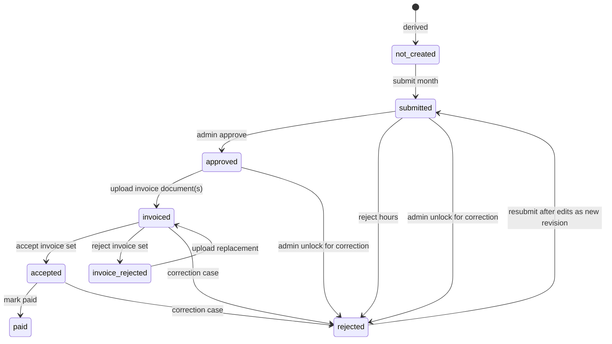

# Domain Model

Date: 2026-06-29

## Purpose

This document defines the Sheet Happens business model before writing database migrations. It
captures the entities, state machines, invariants, and authorization boundaries that the database
schema must preserve.

Sources:

- `../Sheet happens - funkcionális és architekturális specifikáció.pdf`
- `../Sheet happens - tech stack.md`
- `../components.md`
- Current component-library contracts in `src/components`

## Core Principles

- The system is single-tenant and internal. There is no client/customer account, no customer portal,
  and no customer invoice entity.
- Time entries are the source of truth while a period is open.
- Submitted timesheets are financial workflow records. A contractor/month timesheet is a container
  with immutable revisions; each revision snapshots time entries plus resolved rates. They must not
  keep recalculating from mutable source entries.
- Users always have exactly one active profile at a time: `employee` or `contractor`. Historical
  profile periods must remain reportable.
- Internal rates are visible to the owning user and admins, but never to other ordinary users.
- Contractor invoice files are stored documents for verification only. The system does not issue or
  send invoices.
- Reports are derived from time tracking. Timesheet/invoice screens do not provide external export.
- Server-side authorization must enforce every profile and role rule. UI hiding is not a security
  boundary.
- Every material business change must produce a domain event or audit log entry.

## Actors

### Admin

An admin has full back-office access:

- Invite, edit, inactivate, and delete users.
- Manage projects, project groups, assignments, and internal rates.
- Review time entries and monthly contractor timesheets.
- Approve or reject timesheets with a reason.
- Review uploaded contractor invoices, accept or reject invoice sets, and mark paid.
- Generate reports and exports with or without internal costs.
- Edit the information/help content.
- Upload employee payslips.

There are no partial admin roles in v1.

### Member

A non-admin member can be either an `employee` or a `contractor`.

Employee profile:

- Can track time.
- Has central effective-dated internal rates.
- Cannot access timesheet or contractor invoice workflows.
- Never produces contractor timesheets or contractor invoices.

Contractor profile:

- Can track time.
- Has central effective-dated default rates.
- May also have project-assignment-specific effective-dated override rates.
- Can submit monthly timesheets.
- Can upload contractor invoice documents after timesheet approval.

## Identity And Account Model

Better Auth should own the authentication tables: user, session, account, verification, passkey,
two-factor, and related auth records.

The Sheet Happens domain should own a separate member profile record linked one-to-one to the Better
Auth user. This keeps generated auth schema ownership separate from business data.

Domain member data:

- Legal/display name split into first name and last name.
- Normalized email mirror for admin lists and invitation checks.
- App role: `admin` or `member`.
- Account status: `invited`, `active`, `inactive`, or `deleted`.
- Current profile: `employee` or `contractor`, plus historical profile periods.
- Default currency, timezone, locale.
- Audit metadata.

Invitations are domain records because invite-only access is a business rule. Auth magic links can
be used for activation, but the allowlist and intended role/profile belong in the domain.

## Projects And Groups

Project:

- The required work target for every time entry.
- Has name, optional code/slug, color token, start date, optional end date, active flag, notes, and
  internal flag.
- Active flag gates new time entry creation.
- Internal/collector projects are allowed and should be represented as normal projects, not as a
  separate entity type.

Project group:

- Virtual reporting and filtering group.
- Contains arbitrary projects.
- Does not own assignments or rates.
- Replaces the old customer/client concept. There is no customer entity.

Assignment:

- Connects a member to a project.
- Controls whether the member can record time on that project.
- Has an active date range and active flag.
- Owns project-level contractor rate overrides.
- Owns the optional tracking-mode override.
- Must remain historically available after removal.

## Internal Rates

Rates are effective-dated and internal only.

Employee:

- One central effective-dated internal rate timeline per employee.
- No project-specific rate overrides.

Contractor:

- One central effective-dated default rate timeline.
- Optional project-assignment-specific override rate timelines.
- If an override exists for an assignment and date, it wins.
- If no override exists for the assignment/date, the central default rate for that date is used live
  while the period is open.
- On timesheet submission, the resolved rate is snapshotted. Later default-rate changes do not alter
  submitted timesheets.
- A rate change that changes currency must start at the beginning of a future month, or today if
  today is the first day of the month. This prevents one contractor month from spanning currencies.

Rate resolution output:

- Amount.
- Currency.
- Source: `member_default` or `project_override`.
- Source rate period id.
- Effective date range used.

Design rule: v1 avoids currency conversion. It can support multiple currencies globally, but a
contractor monthly timesheet revision has exactly one currency. Currency changes are only allowed at
month boundaries.

## Time Tracking

Tracking mode:

- Two ways a member's hours reach the system. `tracked` means Sheet Happens holds them entry by
  entry — the grid, the form, the timer. `declared` means another company's system holds them, and
  the member records one figure per project per month plus a proof PDF.
- `members.default_tracking_mode` is the member-level default; `project_assignments.tracking_mode`
  is a nullable override where `null` inherits the default. A hybrid member — some projects tracked
  here, some declared — falls out of that for free.
- `resolveTrackingMode(member, assignment)` is the single authority, the way
  `resolveTimesheetLineRate` is for rates.
- **Deliberately not effective-dated**, unlike rates. It governs what a member may create now, not
  how past records are read, because a declaration and a time entry are distinct records, so
  history is self-describing. Assignment-level history is still available where it matters, since an
  assignment already has a valid-from/valid-to range.
- Switching the mode is **refused** while an open month already holds data of the other kind, with
  an error naming what has to be removed first — orphaning a month's entries or a declaration
  silently is worse than refusing. An open month is any month that is not locked: for a contractor
  that is every month without an active period lock, and for an employee, who has no lock at all,
  every month holding data. A change to the member default only checks the assignments that inherit
  it; one carrying an explicit override is unaffected.

Time entry:

- Belongs to one member, one project, and the assignment used at entry time.
- Has a local work date, timezone, optional start/end instants, duration in minutes, description, and
  input source: grid, form, timer, or declared.
- Project is mandatory.
- The source records are not individually approved.
- Warnings such as more than 24 hours/day, overlaps, future dates, or very long sessions are data
  quality signals, not hard database blocks.

Editable period rule:

- Users can edit open periods.
- Once a contractor submits a monthly timesheet, that member/month is locked.
- Locked source time entries cannot be edited by the member.
- Admin rejection or admin unlock is required for corrections.

Inactive project week:

- A member can mark a project/week inactive.
- This removes the member/project/week from missing-hours flags.
- Applies to both employees and contractors.

Running timer:

- A member can have at most one running timer.
- Stopping a timer creates a time entry.
- Timer state is operational state, not financial history.

Draft/autosave:

- Draft grid or form input can be stored separately from committed time entries.
- Drafts should not affect reports or timesheet previews.

## Timesheet Workflow

Timesheet is contractor-only and monthly-only. A `timesheet` represents one contractor and one
month. A `timesheet_revision` represents one immutable submitted financial snapshot for that month.

The current timesheet status is the status of the current revision. Older revisions stay available
for audit and invoice correction history.

Derived statuses:

- `not_created`: no persisted timesheet exists, but the contractor has relevant time or active
  assignments for the month.
- `missing`: admin dashboard/reporting label for expected but absent monthly activity.

Persisted statuses:

1. `submitted`: contractor submitted a revision. A snapshot exists and the period is locked.
2. `rejected`: admin rejected the timesheet because hours need correction. The period is unlocked.
3. `approved`: admin approved the hours. Invoice upload is enabled.
4. `invoiced`: contractor uploaded one or more invoice documents. Admin review is pending.
5. `invoice_rejected`: admin rejected the uploaded invoice set. Hours remain approved and locked.
6. `accepted`: admin accepted the invoice set. Payment is pending.
7. `paid`: admin marked the timesheet paid/closed. This is terminal.

State transitions:

Important distinction:

- Timesheet rejection before invoice upload means the time data is wrong. It unlocks the period for
  correction and the next submission creates a new revision.
- Invoice rejection means the uploaded invoice is wrong. It does not unlock source time and does not
  invalidate approved hours.

Timesheet revision snapshot:

- Created on submission/resubmission and never mutated after creation.
- Contains one line per source time entry with resolved rate, currency, project, assignment, local
  date, description, duration, and calculated amount.
- Contains one currency, total minutes, and total amount.
- Must be immutable once created; corrections create later revisions instead of mutating older
  revisions.

Period lock:

- A lock is per contractor and month.
- Lock starts on submission.
- Lock remains through approved, invoiced, accepted, and paid.
- Lock is removed on timesheet rejection or explicit admin unlock for time correction.

## Contractor Invoice Workflow

Invoice documents:

- Can only be uploaded for approved or invoice-rejected timesheet revisions, or as cancellation
  invoices in a correction case.
- One or more invoice documents can exist for a month and for a revision.
- Stored privately through object storage metadata.
- Can be replaced or deleted until they become accepted or paid-relevant audit history.
- Are not generated by Sheet Happens.
- Store invoice number, declared amount, and currency as human-entered review metadata. These values
  are useful but not trusted as proof that the PDF is correct.

Invoice roles:

- `original`: the first invoice uploaded for an approved revision.
- `replacement`: replacement for a rejected or deleted invoice before acceptance.
- `cancellation`: negative invoice or modifying document that cancels a previously accepted
  incorrect invoice.
- `corrected`: invoice uploaded for a corrected revision.

Admin invoice review:

- Side-by-side timesheet snapshot and PDF preview.
- No automatic match detection in v1.
- Admin can accept invoice set, reject invoice set with mandatory reason, or leave without status
  change.
- Rejection reason is visible to the contractor.

Correction after invoice issue:

- Once an invoice was issued for an incorrect revision, Sheet Happens keeps the original revision and
  invoice as audit history.
- Admin opens a correction case from the incorrect revision.
- If the incorrect invoice was accepted or paid-relevant, the contractor must upload a cancellation
  invoice that references the incorrect invoice and has the negative declared amount.
- The corrected month is submitted as a new immutable timesheet revision.
- The corrected invoice is linked to the corrected revision.
- A corrected month can therefore have at least three invoice documents in history: incorrect
  original, cancellation, and corrected invoice.
- Paid corrections are allowed only as an exceptional admin flow with mandatory reason and audit log.

Payment:

- No Wise or payment-provider integration.
- `paid` is an internal marker that the admin sets after payment happens outside the system.

## Reporting And Export

Reports are based on time entries for open/current data and on timesheet revision snapshots where a
financial workflow needs frozen historical values.

Report filters:

- Date range: day, week, month, year, or custom range.
- Project.
- Project group.
- Member.
- View mode: user view or project view.

Export modes:

- `cost_free`: hours and descriptions only. No rates, costs, or internal amounts.
- `internal`: includes rates and calculated costs.

Export behavior:

- Admin can edit export data on the fly before generating the PDF.
- Those edits do not modify source time entries unless the admin explicitly saves them back.
- Generated report PDFs are stored as private documents with signed access.
- The reporting module must be shared by the UI export and the read-only MCP endpoint.

## Notifications And Reminders

Email notification types:

- Invitation.
- Password reset or activation.
- Weekly time-entry reminder for all members.
- Monthly invoice reminder for contractors.
- Timesheet submitted.
- Timesheet approved.
- Timesheet rejected.
- Invoice uploaded.
- Invoice rejected.
- Invoice accepted.
- Timesheet paid.

Notification state to track:

- User preferences where applicable.
- Delivery attempts and provider ids.
- Job runs for scheduled reminders.
- Idempotency keys for repeated jobs.

Runtime scheduling intentionally uses one in-service scheduler for v1. Every Next.js Node server
starts the same sequential 15-second loop; a PostgreSQL advisory lock permits only one application
instance to dispatch at a time. Persisted cursors and idempotency recover delayed work after a
restart. This deliberately replaces the specification's external-scheduler recommendation while
the application is deployed as a small internal service.

Missing-hours flags are derived:

- Active assignment exists for member/project/week.
- No time entry exists for that member/project/week.
- No inactive week marker exists.

## Documents

One generic document metadata model should cover:

- Contractor invoices.
- Report exports.
- Payslips.

The database stores metadata and object-storage keys, not binary file blobs.

Document access:

- Private bucket/object.
- Signed URL generated on demand.
- Short-lived URL only.
- Audit downloads for sensitive documents if required.

## Payslips

Payslips are in v1 scope. Treat them as a small payroll-document module, not part of the contractor
timesheet workflow.

Scope:

- Admin uploads payslip PDFs for employee-profile members.
- Employee sees monthly payslip history and can preview/download.
- Contractors are hidden from the payslip employee picker.
- One payslip record per employee/month.
- Document storage uses the shared document metadata table.

## Leave

Leave is an employee-only module: who is away when, recorded by the employee and bookkept by the
admin. Contractors neither see it nor appear in it. Code: `src/server/leave`, screens `/leave` and
`/admin/leave`.

Model:

- `leaves`: member, type (`vacation` | `sick`), start and end date, day part (`full` | `morning` |
  `afternoon`), optional note, optional sick note (a `documents` row of type `sick_note`), the
  admin's HR tick (`hr_processed_at`, `hr_processed_by_member_id`), soft delete.
- A half day is only possible on a single date; the database enforces it with a check constraint,
  alongside `end_date >= start_date`.
- Workdays are never stored. They are Monday to Friday minus public holidays, counted on read by
  `countLeaveWorkdays` (`src/lib/leave-days.ts`), which the form also uses for its live count. A half
  day is 0.5.
- `public_holidays` caches Hungary's holidays from the keyless Nager.Date API per year
  (`public_holiday_years` marks a year as fetched). A missing year is fetched on demand, at most
  five years from today; the notification dispatcher refreshes this year and next every 30 days.
  If the API is down the calendar shows no holidays for that year and nothing else breaks.
  Hungarian transferred workdays are not modelled.

Rules:

- No approval. A leave is valid the moment it is recorded. The admin's only state is the HR tick,
  which the employee never sees.
- An employee records leave for themselves only, starting no earlier than the 1st of their current
  month (their own time zone). Recording stays open until the month ends; the month-end reminder's
  "by 12:00 tomorrow" is a request, not a lock.
- A leave must contain at least one workday, may not be longer than a year, and may not overlap the
  member's other live leave, except that a morning and an afternoon can share a day. Writes take a
  row lock on the member so two tabs cannot both pass the overlap check.
- After recording, an employee can only add or replace the sick note on a sick leave, at any time,
  also for a past month. Editing, deleting and removing a sick note are admin actions; an admin
  edit may move a leave into the past but is held to the overlap and workday rules.

Visibility:

- Colleagues see each other's leave on the calendar as `Away`: name and dates, never the type, the
  note or the sick note. The redaction happens in `listLeaveCalendar`, not in the UI.
- The owner and admins see everything. The sick note is served through a short-lived signed URL
  from `/api/leave/[leaveId]/attachment`, which answers 404 to anyone else.

Audit: `leave.created`, `leave.updated`, `leave.deleted`, `leave.hr_processed`,
`leave.hr_unprocessed`, `leave.attachment_uploaded`, `leave.attachment_removed`,
`leave.attachment_read`.

Reminder: `LEAVE_MONTH_END_REMINDER` goes to every active employee, email and in-app, on the
second-to-last day of the month at 9:00 company time.

## Information Page

The functional spec mentions Contentful, while the tech-stack document later suggests Postgres-backed
markdown with a built-in editor. The current component library has a markdown editor.

Recommended v1:

- Store markdown in Postgres.
- Maintain draft/published states.
- Keep versions for rollback and audit.
- Revisit Contentful only if non-admin content editors need a separate CMS.

## Audit And Observability

Use two related records:

- Workflow events for user-visible history on timesheets, invoices, reports, and documents.
- Generic audit logs for security/operational accountability.

Audit log should record:

- Actor.
- Action.
- Target type and target id.
- Before and after summaries where useful.
- Request id, IP address, user agent where available.
- Timestamp.

Audit should cover at minimum:

- User invite/edit/inactivate/delete.
- Profile transitions.
- Project and assignment changes.
- Rate changes.
- Time period unlocks.
- Timesheet submit/approve/reject/resubmit.
- Invoice upload/accept/reject/delete/replace.
- Paid marking.
- Payslip upload/delete/replace.
- Info page publish.

## Authorization Invariants

Server-side rules must enforce:

- Only admins can manage users, projects, assignments, rates, reports, payslips, and info-page
  publishing.
- Members can only read/write their own time entries for open periods.
- Employees cannot create timesheets or upload contractor invoices.
- Contractors can only create/view their own timesheets and invoices.
- Members can only view their own rates.
- Cost-free exports must never expose rates or amounts.
- Report export with internal costs is admin-only.
- Document signed URLs must be scoped to a user who can access the document.

## Resolved Design Decisions

- Payslips are included in v1.
- Referenced business records use soft deletion by default. Hard delete is allowed only for
  unreferenced setup mistakes with extra admin care.
- GDPR erasure should be handled through a later anonymization/scrubbing workflow that removes
  unnecessary personal data while preserving legally required accounting and audit records.
- Contractor monthly timesheets are single-currency. Currency-changing rates must begin on a month
  boundary.
- Invoice uploads collect invoice number, declared amount, and currency as untrusted review metadata.
- Invoiced/accepted corrections use immutable timesheet revisions plus correction cases, including
  cancellation invoices where legally required.
- Project groups are current-only organization helpers; they do not need effective-dated history in
  v1.
- Report exports store rendered snapshot JSON plus generated document metadata.
- `accepted` remains a persisted timesheet status.
